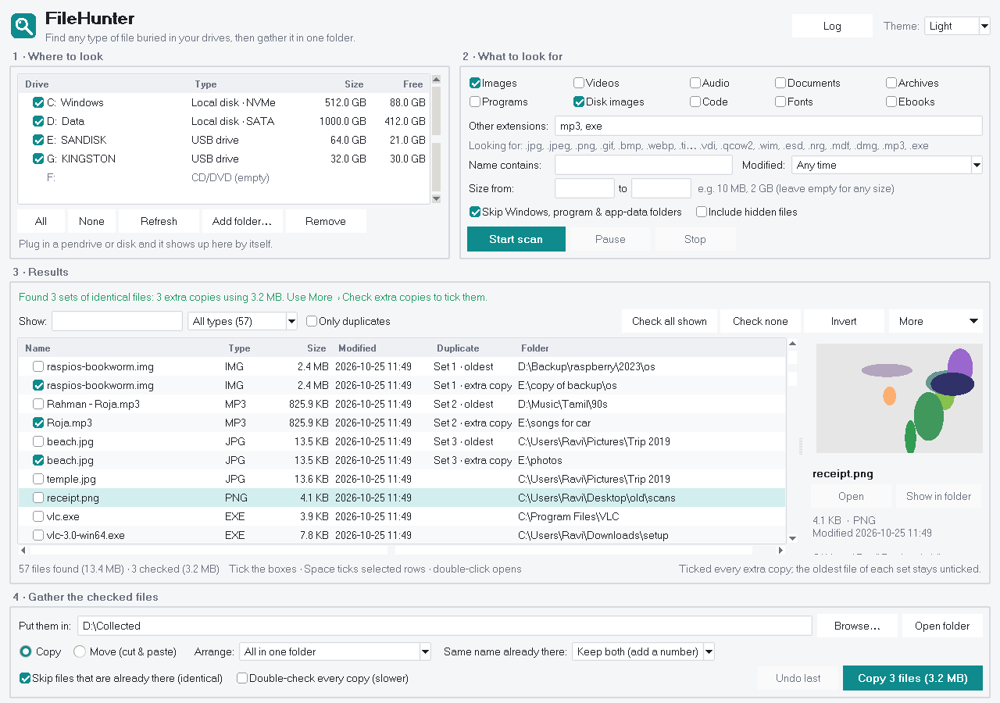
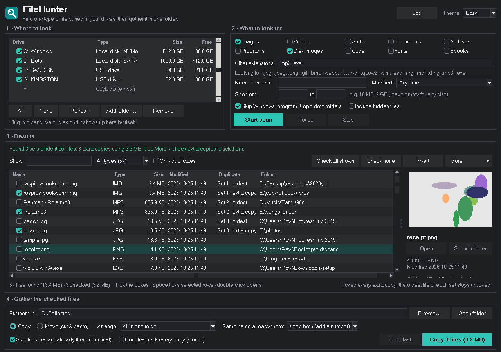

# FileHunter

**Find every file of a type on all your drives, even ones buried twenty folders deep, and gather them into one folder.**

Looking for every `.img` you ever downloaded, every `.mp3` scattered across old backups, every installer `.exe`
hiding in sub-folders of a pendrive? Tick the drives, tick the file types, press **Start scan**, tick what you
want, and copy or move it all into one place.



<details><summary>Dark theme</summary>



</details>

## What it does

**1 · Where to look**
- Detects every drive automatically: C:, D:, E:…, pendrives, SD cards, USB hard disks and SSDs,
  CD/DVD, network drives. Shows each drive's name, type (NVMe, SATA, USB…), size and free space.
- Plug a pendrive in while the app is open and it appears by itself, already ticked.
- Untick any drive you don't want searched (it's remembered next time). Add any extra folder too.

**2 · What to look for**
- Ready-made groups: Images, Videos, Audio, Documents, Archives, Programs, Disk images, Code, Fonts, Ebooks
  (hover a group to see its extensions).
- Type any other extensions: `img, iso, mp3, exe`.
- Optional filters: name contains (wildcards `*` `?`, several with `;`), size range (`10 MB` to `2 GB`),
  modified in the last week / month / year or older than a year.
- Skips Windows, Program Files, AppData, Recycle Bin and similar by default, so you get *your* files,
  not thousands of program and cache files. Untick it to search everything.

**3 · Results**
- Searches every folder and sub-folder, several drives at once, with live progress, pause and stop.
- Tick boxes, sort by any column, type to filter, show one file type at a time.
- Photo preview, **Open**, **Show in folder**, right-click to tick everything in a folder or of a type.
- **Find duplicate files** compares real file contents (not just names) and can tick every extra copy,
  keeping the oldest one.
- Export the list as CSV (opens in Excel) or copy the paths.

**4 · Gather the checked files**
- **Copy** or **Move (cut & paste)** into one folder.
- Arrange them all in one folder, by file type (`MP3\`, `JPG\`…), by month (`2024-05\`…),
  or keeping the original folder structure.
- When a name is already taken: keep both (`photo (2).jpg`), skip, replace, or replace only if newer.
  Identical files that are already there are skipped automatically.
- Checks free space first, shows speed and time left, can pause and stop
  (a half-copied file is always cleaned up), and can double-check every copy.
- **Report** shows every file that was *not* copied and why (file open in another program, drive full,
  no permission, already there…). **Retry failed** tries them again once you've fixed the cause, and the
  list can be exported to CSV.
- **Undo last** puts moved files back where they came from, or removes the copies it made.
- Warns before moving anything out of Windows or program folders, which could break programs.
- **Delete checked…** sends the ticked files to the Recycle Bin (or Trash), where you can restore them,
  or deletes them permanently after a second confirmation. It warns when files are on a pendrive or
  memory card, where Windows has no Recycle Bin.

## Run it

You need **Python 3.9 or newer** ([python.org/downloads](https://www.python.org/downloads/); on Windows tick
*"Add python.exe to PATH"* during setup).

| System  | Start it by |
|---------|-------------|
| Windows | double-clicking **`start_windows.bat`** |
| macOS   | double-clicking **`start_macos.command`** (first time: right-click › Open) |
| Linux   | running **`./start.sh`** (needs `python3-tk` and `python3-venv`) |

The first start takes about a minute to prepare; after that it opens straight away.
Settings are saved in `%APPDATA%\FileHunter` (Windows), `~/Library/Application Support/FileHunter` (macOS)
or `~/.config/filehunter` (Linux).

Ready-made apps for each system are attached to every [release](../../releases).

## Tips

- Searching a whole C: drive with *Skip Windows…* turned off can take a while and finds many program files.
  Leave it on unless you need those.
- Folders the app isn't allowed to open are skipped and listed under **Log**.
- Moving files to another folder on the **same drive** is instant; moving to another drive copies first,
  checks the copy, then removes the original.
- Keyboard: `Space` ticks the selected rows, `Ctrl+F` jumps to the filter box, `Enter` opens a file,
  `F5` refreshes drives, `Esc` stops a scan.

## For developers

```bash
python -m venv .venv && . .venv/bin/activate   # Windows: .venv\Scripts\activate
pip install -r requirements.txt pytest
python -m pytest -q tests                      # engine tests
python filehunter.py                           # run the app
pip install pyinstaller && python build.py     # single-file app in dist/
```

`filehunter_core.py` holds all the logic (drive detection, scanning, duplicates, copy/move, undo)
with no GUI code; `filehunter.py` is the Tkinter window. Only the standard library is required.

Pushing a tag such as `v1.0.0` makes GitHub Actions test on Windows, macOS and Linux, build the three apps
and publish them as a release.

## License

MIT, see [LICENSE](LICENSE).
